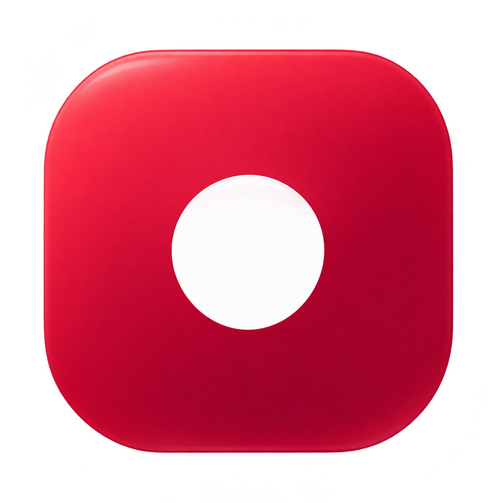
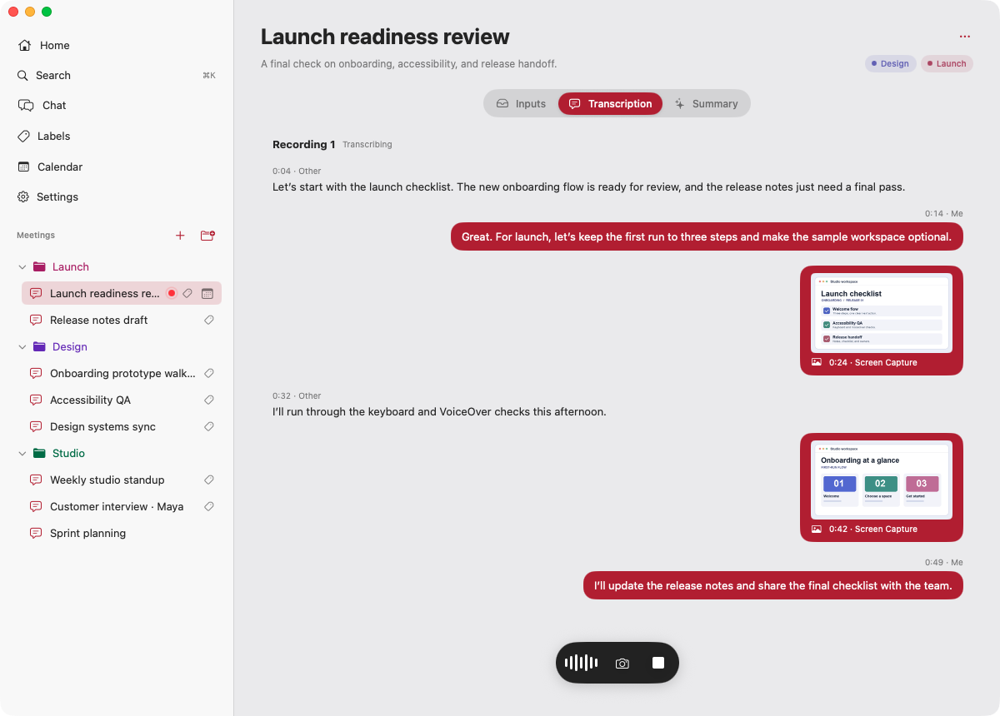
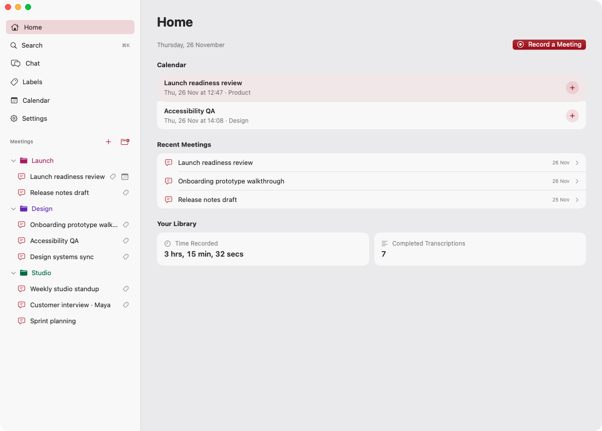
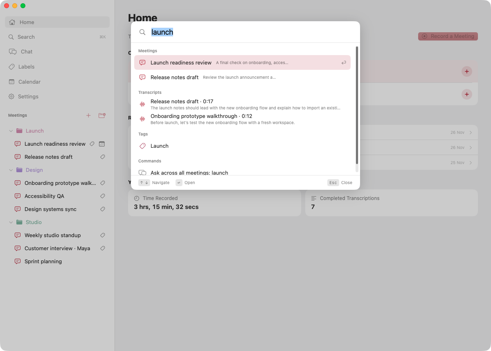
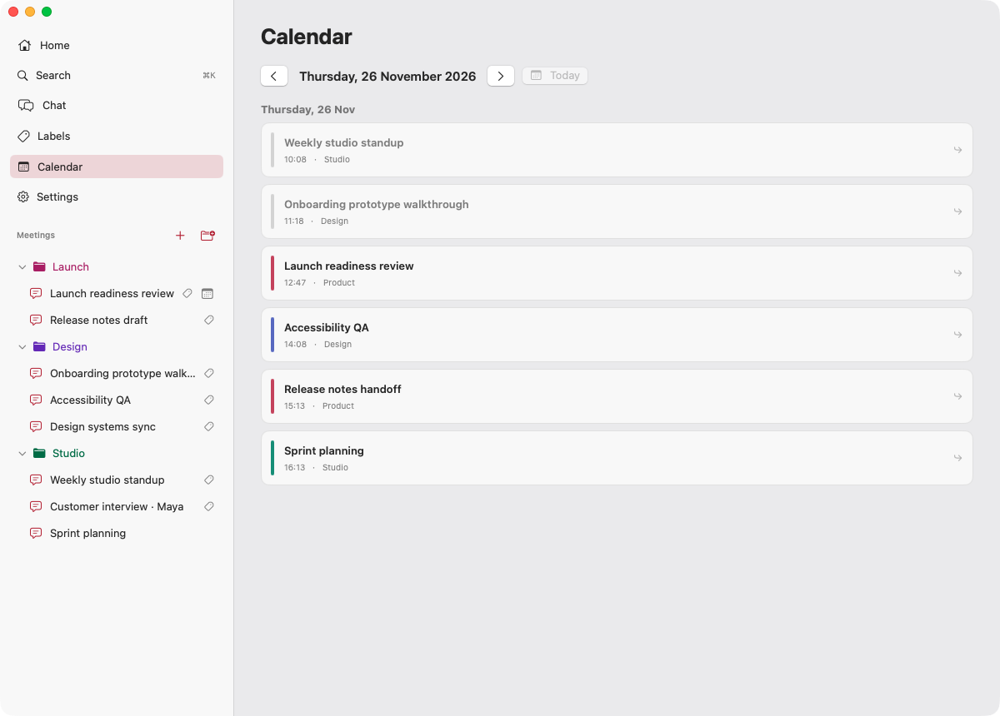

# Meeting Record

[](https://github.com/raphaelkieling/meeting-records/actions/workflows/main.yml)
[](https://github.com/raphaelkieling/meeting-records/releases)

<p align="center">
  
</p>

A private, local-first macOS app for recording and transcribing meetings, organizing conversations, and generating AI summaries. Meeting data stays on your Mac in a SQLite library.



| Home | Search | Calendar |
| --- | --- | --- |
| [](docs/screenshots/home.png) | [](docs/screenshots/search.png) | [](docs/screenshots/calendar.png) |

Screenshots use sample meetings, transcripts, and screen captures.

Home and Settings stay above the scrollable Meetings list. Use arrow keys to move focus and Return or Space to select.

Meetings and transcripts are stored in `~/Library/Application Support/MeetingRecord/meetings.sqlite`, with recordings kept alongside the library on your Mac.

## Build from source

Requires Apple Silicon, macOS 14+, and Xcode 26.3 or later.

Build and open the app:

```sh
./run
```

To keep macOS privacy permissions across rebuilds, sign with the same code-signing identity each time. The build automatically uses an Apple Development or Developer ID Application identity if exactly one is available. If there are several, run `security find-identity -v -p codesigning` and save the desired identity's fingerprint as a single line in `.build/signing-identity`. The `MEETING_RECORD_SIGNING_IDENTITY` environment variable takes precedence.

Without a signing identity, the build uses ad hoc signing and macOS can request permissions again after code changes. Create an Apple Development certificate under Xcode → Settings → Accounts → Manage Certificates if you need an identity. macOS can ask you to grant permissions again the first time you launch the app with the new signature.

To change the app icon, replace [Resources/AppIcon.png](Resources/AppIcon.png) with a square PNG (at least 1024 × 1024 pixels) and run `./run` again. The build generates the macOS icon, and Settings uses the icon from the app bundle.

Run `./scripts/build-dmg.sh` from a logged-in macOS desktop session to build `.build/MeetingRecord.dmg`. Open the disk image and drag **Meeting Record** into **Applications**. The disk image uses the local build signature. Its Finder background is in [Resources/DMGBackground.png](Resources/DMGBackground.png).
